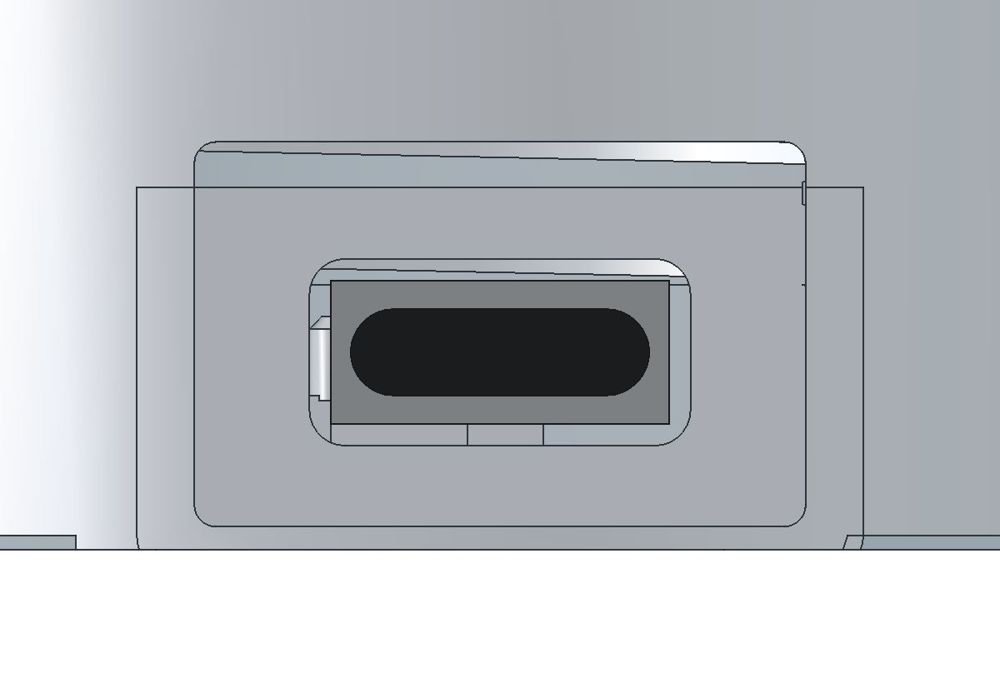

# ESP32 원형 디스플레이 맥세이프 케이스

# ESP32-2424S012 MagSafe Case

1.28인치 원형 ESP32 터치 디스플레이용 케이스. 현재 버전은 **V18**이다. PLA 출력, 분리형 보드 고정 링, 내부 자석 홈, 50×30×5mm 배터리 받침판으로 구성된다.

## 먼저 볼 것

- [한영 프로젝트 보고서 PDF](reports/V18/ESP32-2424S012_V18_PROJECT_REPORT_KO_EN.pdf) · [수정용 원문](reports/V18/PROJECT_REPORT.ko-en.md)
- [보고서·한영 조립 영상 포함 최신 전체 ZIP](https://github.com/mk0000001/ESP32-2424S012-MagSafe-Case/releases/download/v18/ESP32-2424S012_V18_COMPLETE_KO_EN.zip)

- [V18 출력 파일 6개](print/V18/)
- [FreeCAD 원본](cad/V18/ESP32_2424S012_FIT_V18.FCStd)
- [한영 조립 방법](docs/ASSEMBLY.ko.md)
- [47초 한영 조립 영상](media/V18/assembly.mp4) · [반복 GIF](media/V18/assembly.gif)
- [사용 하드웨어 전체 목록](hardware/BOM.md)
- [모듈 사양서·회로도·구조도·사용 설명서](hardware/ESP32-2424S012/vendor/)
- [배터리 모델 식별](hardware/battery/YCJ-603048.md)
- [V18 전체 묶음과 모듈 원본 ZIP](https://github.com/mk0000001/ESP32-2424S012-MagSafe-Case/releases/tag/v18)

## V18에서 바뀐 부분

배터리가 흔들린다는 실물 피드백을 반영했다. 받침 돌기를 0.5mm 높여 위아래 여유를 0.8mm에서 0.3mm로 줄였다. 가이드 안쪽은 51×31mm에서 50.6×30.6mm로 줄이고, 가이드 높이는 3.2mm로 높였다. 배터리를 누르는 조임은 넣지 않았다.

USB-C 구멍 안쪽에는 1.2mm 두께의 기판 가림벽을 추가했다. 바깥의 17×10.7mm 케이블 머리 공간은 유지하고, 커넥터 뒤쪽의 통과 창만 10.6×5.2mm로 좁혔다. 고정 링과 닿지 않도록 가림벽 아래쪽을 띄웠다.

**V17을 이미 출력했다면 본체와 안쪽 배터리 받침판 2개만 다시 출력하면 된다.** 보드 받침틀·나사 링·바깥 뚜껑·조임 툴은 V17 형상을 그대로 사용한다.

## 출력

`print/V18/`의 `_PRINT.stl` 6개를 각각 1개, **100% 배율**, 저장된 방향으로 출력한다. 케이스 부품은 5개이고 나머지 1개는 조립 후 빼는 링 조임 툴이다. 상세 설정은 [출력 안내](docs/PRINTING.ko.md)에 있다.

## 하드웨어 기준

| 부품 | 현재 확인한 값 |
|---|---|
| 디스플레이 보드 | ESP32-2424S012 계열, PCB `HW-791` / `V0.0.1`, ESP32-C3-MINI-1U |
| 화면 | 1.28인치 IPS, 240×240, GC9A01; 사용자 제공 상품은 정전식 터치형 |
| 배터리 | 사진 라벨 `YCJ 603048`, 3.7V, 880mAh; CAD는 사용자 실측 50×30×5mm 기준 |
| 배터리 유통 모델 후보 | Coms UB917. 같은 모델 코드·전압·용량이지만 구매 포장/주문 SKU는 미확인 |
| 자석 스티커 | 실물 치수 미확정. 임시 외경56 / 내경46 / 두께0.55mm 기준 |

배터리 판매자 자료에는 30×50×6mm로 적혀 있다. 현재 케이스는 사용자의 **5mm 실측**을 적용했으므로 6mm 대체 배터리를 검증된 호환품으로 보지 않는다. 자석도 실측 후 맞춤 보정할 항목이다.

## 검증 범위

6개 STL의 수밀성·면 방향·양의 체적·단일 연결체를 검사했다. CAD에서 케이스 조립, 링과 툴 회전, 배터리 이동 한계, 뚜껑 잠금, 케이블 삽입 27가지 자세를 확인했다. [검사 기록](validation/V18/)에 결과를 저장했다. V18 실제 출력의 체결력·자력·반복 내구성은 아직 시험 전이다.

사진은 하드웨어 식별용이며 이전 출력물 조립 사진을 포함한다. 애니메이션의 보드·커넥터·배터리·자석은 위치 설명용 외형이다. 제조사 원본 자료에는 전체 모듈 STEP/STP가 없어서 실제 모듈 3D CAD를 제공하는 것으로 표시하지 않았다.

## 폴더

`print/` 출력 STL · `cad/` FreeCAD와 BREP · `hardware/` 부품표와 원본 자료 · `media/` 영상과 그림 · `docs/` 출력/조립/변경 설명 · `source/` V18 재생성 스크립트 · `validation/` 검사 결과.

업데이트: 2026-10-31, Asia/Seoul. 모듈 원본 자료와 제품 사진의 권리는 각 권리자에게 있다.

## English

V18 enclosure for the 1.28-inch ESP32-2424S012 family round touch display. The PLA design uses a separate board support frame, a threaded retaining ring, an internal magnetic sticker recess and a tray for a measured 50×30×5 mm battery. The repository is public. The report, assembly instructions and animation captions present Korean first, followed by English.

### Start here

- [Bilingual project report PDF](reports/V18/ESP32-2424S012_V18_PROJECT_REPORT_KO_EN.pdf) · [Editable report source](reports/V18/PROJECT_REPORT.ko-en.md)
- [Latest complete package with report and bilingual animation](https://github.com/mk0000001/ESP32-2424S012-MagSafe-Case/releases/download/v18/ESP32-2424S012_V18_COMPLETE_KO_EN.zip)
- [Six print files](print/V18/) · [Native FreeCAD model](cad/V18/ESP32_2424S012_FIT_V18.FCStd)
- [Bilingual assembly instructions](docs/ASSEMBLY.ko.md) · [47-second video](media/V18/assembly.mp4) · [Looping GIF](media/V18/assembly.gif) · [Subtitles](media/V18/assembly.ko-en.srt)
- [Hardware BOM](hardware/BOM.md) · [Original module documentation](hardware/ESP32-2424S012/vendor/) · [Battery identification](hardware/battery/YCJ-603048.md)
- [V18 release and original module ZIP](https://github.com/mk0000001/ESP32-2424S012-MagSafe-Case/releases/tag/v18)

### V18 changes

Battery supports are raised by 0.5 mm, reducing nominal vertical travel from 0.8 to 0.3 mm. The guide interior is reduced from 51×31 to 50.6×30.6 mm and its total height is 3.2 mm. The nominal battery is not compressed. A 1.2 mm PCB sight shield is added behind the USB-C opening. The outer 17×10.7 mm cable recess and insertion depth are retained, with a 10.6×5.2 mm rear socket window and clearance for ring rotation.

**If you already printed V17, reprint only BODY_V18_PRINT.stl and BATTERY_TRAY_INNER_V18_PRINT.stl.** The support frame, retaining ring, outer lid and tightening tool retain their V17 geometry.

### Printing and hardware

Print one of each of the six `_PRINT.stl` files at 100% scale in their stored orientation: five case parts and one reusable tool. Start with PLA, a 0.4 mm nozzle, 0.2 mm layers and at least four walls. The tool is designed to print handle-down without support; inspect actual bridging in the slicer. Use the tool by hand and remove it before installing the battery.

The actual PCB is marked HW-791, ESP32-2424S012 and V0.0.1, with an ESP32-C3-MINI-1U module. Supplied specifications describe a 1.28-inch 240×240 IPS display with GC9A01. The user product reference is capacitive touch; the exact N/C SKU suffix is unconfirmed. The battery label reads YCJ603048, 3.7 V, 880 mAh. Coms UB917 is a matching distribution candidate, not a confirmed purchase SKU. Its supplier dimensions are 30×50×6 mm; this case uses the user's 50×30×5 mm measurement, so a 6 mm replacement is not established as compatible. Connector series, pitch and polarity are unconfirmed.

The magnetic sticker uses provisional dimensions of 56 mm OD, 46 mm ID and 0.55 mm thickness. Measure the actual sticker before bonding. The hidden recess is 57.2 mm OD, 44 mm ID and approximately 0.667 mm deep, behind a continuous 0.6 mm outer plastic skin.

### Validation and files

All six STLs passed watertightness, consistent winding, positive-volume and single-connected-solid checks. CAD checks cover assembled clearances, ring/tool motion, battery travel, lid locking and 27 cable insertion poses. See [verification records](validation/V18/). Physical V18 fit, retention force, magnetic holding force and repeated-use durability remain untested. Hardware photos include earlier prints. Electronics, battery and magnet CAD are explanatory envelopes; the supplied archive contains no full-module STEP/STP.

`print/` contains STL; `cad/` native CAD and BREP; `reports/` the report; `hardware/` BOM and original documents; `media/` animation and figures; `docs/` instructions; `source/` rebuild scripts; and `validation/` check results. Updated 31 October 2026, Asia/Seoul. Original documents and product photos remain the property of their respective rights holders.
